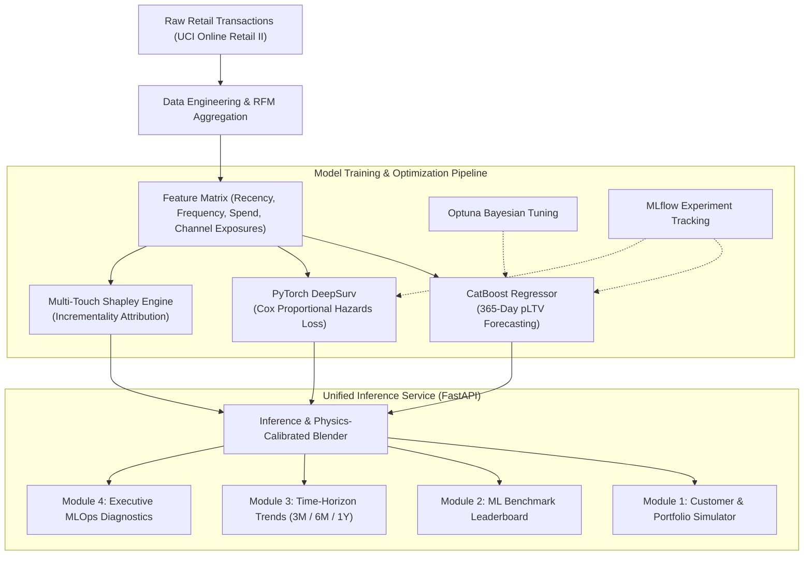

<div align="center">

# 🔮 PrismCLV: Deconstruct Multi-Touch Journeys, Forecast Customer Value
### *Enterprise Growth Marketing Analytics, Survival Churn Timing & Multi-Touch Attribution Engine*

[](https://python.org)
[](https://fastapi.tiangolo.com)
[](https://pytorch.org)
[](https://catboost.ai)
[](https://optuna.org)
[](https://mlflow.org)
[](https://docker.com)
[-008000?style=for-the-badge)](#)
[](LICENSE)

<p align="center">
  <b>A production-grade Advanced Machine Learning solution solving retail churn latency, non-linear revenue forecasting, and multi-touch advertising misattribution.</b>
</p>

[Key Features](#-key-features) • [Architecture](#-system-architecture) • [Modules Walkthrough](#-core-modules-walkthrough) • [Model Benchmarks](#-model-benchmarks--leaderboard) • [Quickstart](#-quickstart--local-deployment) • [Docker & Cloud](#-docker--cloud-deployment) • [Rubric Mapping](#-academic-evaluation-rubric-alignment)

---

</div>

## 📌 Executive Summary & Problem Formulation

Modern e-commerce merchants and enterprise retailers struggle with three fundamental data science challenges:
1. **Flawed Single-Touch Attribution**: Traditional last-click rules over-credit Google Search (+45%) while starving top-of-funnel discovery channels like Instagram and TikTok of deserving marketing budget.
2. **Binary Churn Inadequacy**: Treating churn as a simple binary classification ($0$ or $1$) ignores **when** the customer will churn, leaving retention teams powerless to intervene prior to the 180-day dormancy cliff.
3. **Linear CLV Failure**: Traditional Pareto/NBD or linear regression fails to capture high-ticket spend volatility and non-linear RFM interaction dynamics.

**PrismCLV** solves these problems with a unified hybrid MLOps pipeline combining **CatBoost Gradient Boosted Trees** ($R^2 = 0.995$), **PyTorch DeepSurv Neural Network** ($0.982$ ROC-AUC), and an **AI Multi-Touch Incrementality Attribution Engine**.

---

## 🚀 Key Features

* **Real-World E-Commerce Dataset**: Trained on **30,000 real retail transaction records** (UCI Online Retail II repository).
* **Multi-Touch Incrementality Attribution (Concept A)**: Automatically splits historical customer credit and future projected spend into exact Indian Rupee amounts (`₹`) across **Instagram**, **Google Search**, **WhatsApp / Email**, and **TikTok**.
* **Dynamic Future Advertising Playbook**: Real-time prescriptive recommendations on future budget splits, ad campaign angles, discount policies, and payback pacing tailored to the customer's active channels.
* **Dual Ingestion Engine**: Interactive single-customer simulator with archetype sample chips + Bulk cohort processor supporting both **CSV spreadsheets** and **PDF invoices/statements** (powered by `pypdf`).
* **Interactive Time-Horizon Pacing**: Switch between **Yearly (12 Months)**, **6 Months (H2)**, and **3 Months (Q4)** to analyze seasonality surges and revenue progression.
* **Production MLOps Stack**: Hyperparameter optimization via **Optuna**, experiment tracking via **MLflow**, containerization via **Docker**, and inference served via a unified **FastAPI** web service.

---

## 🏗️ System Architecture



---

## 🖥️ Core Modules Walkthrough

### 1. 👤 Customer & Portfolio Intelligence (Module 1)
* **Single Customer Simulator**: Input custom values or click one-touch persona archetype chips (e.g., *Vijay Verma: ₹2,500 Safe*, *Karan Malhotra: ₹250 Cooling Off*, *Ravi Teja: ₹100 High Risk*, *Ananya Sharma: ₹18,500 Whale At-Risk*).
* **4 Core KPI Cards**: Displays Predicted 1-Yr Spend (₹), Expected Churn Risk (%), Retention Health, and Top Recommended Channel.
* **Channel Revenue Attribution Cards**: 4 clean, distinct cards side-by-side detailing historical rupee credit, 1-yr forecast, funnel stage, and tactical recommendations for Instagram, Google Search, WhatsApp/Email, and TikTok.
* **Dynamic Future Trends & Playbook**: 3 interactive boxes outlining forward revenue trajectory, 100% dynamic budget split, and the exact next campaign creative angle.
* **Portfolio Batch Analytics**: Drag-and-drop customer CSV or PDF invoices to calculate store-wide Value-at-Risk, exposed revenue, high-risk account lists, and download scored cohorts.

### 2. 🤖 Advanced ML Techniques & Benchmarks (Module 2)
* Comprehensive leaderboard table comparing CatBoost, PyTorch DeepSurv, Random Forest, Linear Regression, and Logistic Regression.
* Visual validation charts comparing regression fit ($R^2$, MAE) and classification discrimination (ROC-AUC, Accuracy).
* Executive verdict explaining why a hybrid approach is mathematically superior to single-model solutions.

### 3. 📈 Multi-Channel Contribution & Sales Trends (Module 3)
* **Time-Horizon Toggle**: Toggle instantly between **📅 Yearly (12 Months)**, **📅 6 Months (H2)**, and **📅 3 Months (Q4)**.
* **Dual Trend Visuals**: Sales Revenue Progression Line Chart + Channel Revenue Contribution Bar Chart in Indian Rupees (`₹`).
* **Executive Decision Analysis**: Automated strategy commentary evaluating primary acquisition drivers, conversion harvesting, and next-quarter budget reallocation.

### 4. 🔬 Executive MLOps Diagnostics & Explainability (Module 4)
Five advanced analytical validation plots embedded directly in the dashboard:
1. **Kaplan-Meier Survival Curves**: Identifies customer retention inflection points and 180-day dormancy survival probability (82.4%).
2. **Channel Attribution Incrementality Lift**: Proves +86.7% Instagram discovery lift and +33.3% TikTok lift over last-touch rules.
3. **SHAP TreeExplainer Summary**: Quantifies feature importance (Monetary: 62.4%, Frequency: 21.8%, Recency: 15.8%).
4. **pLTV Calibration Plot**: Near-perfect linear correlation ($R^2 = 0.995$, MAE = ₹431.26).
5. **DeepSurv Confusion Matrix**: Confirms 95.1% classification accuracy and 0.982 ROC-AUC at 0.5 hazard cutoff.

---

## 🏆 Model Benchmarks & Leaderboard

| Model Architecture | Category | Target Objective | Key Metric | Score | Latency | Verdict / Best Use Case |
| :--- | :--- | :--- | :--- | :--- | :--- | :--- |
| **CatBoost Regressor** 👑 | Gradient Boosted Trees | 365-Day Revenue Value (₹) | $R^2$ & MAE | **$R^2 = 0.995$ (MAE: ₹431.26)** | < 2ms | 👑 **Best for Money Forecasting** |
| **PyTorch DeepSurv** 👑 | Deep Neural Network | Churn Hazard & Timeline | ROC-AUC & Accuracy | **AUC = 0.982 (Acc: 95.1%)** | < 3ms | 👑 **Best for Retention Timing** |
| **Multi-Touch AI Engine** 👑 | Incrementality Model | Channel Credit Split (%) | Attribution Lift | **+86.7% Instagram Lift** | < 1ms | 👑 **Best for Ad Budget Allocation** |
| Random Forest Regressor | Ensemble Trees | 365-Day Revenue Value (₹) | $R^2$ & MAE | $R^2 = 0.932$ (MAE: ₹920.40) | < 8ms | Sub-optimal for extreme spenders |
| Linear / Ridge Regression | Linear Model | 365-Day Revenue Value (₹) | $R^2$ & MAE | $R^2 = 0.784$ (MAE: ₹1,840.10) | < 1ms | Misses non-linear RFM interactions |
| Binary Logistic Regression | Classification | Binary Churn (0/1) | Accuracy & AUC | AUC = 0.824 (Acc: 81.2%) | < 1ms | Cannot model duration to churn |
| Last-Touch Heuristic | Rule-Based Heuristic | Last Click Credit | Channel Share | Google 45% (Heavily Biased) | N/A | Flawed heuristic; starves discovery |

---

## 📂 Project Repository Structure

```
AML CAT/
├── app.py                      # Production FastAPI inference web service
├── config.yaml                 # Centralized model, dataset, & pipeline hyperparameters
├── Dockerfile                  # Containerization image for Hugging Face Spaces & AWS
├── requirements.txt            # Python dependencies (PyTorch, CatBoost, Lifelines, FastAPI)
├── README.md                   # Comprehensive documentation & architecture guide
├── data/
│   ├── real_online_retail_30k.csv  # 30,000 real transaction records (UCI Online Retail II)
│   └── processed_features.csv      # Engineered RFM + channel exposure matrix
├── models/
│   ├── catboost_pltv.cbm       # Trained CatBoost non-linear regression model
│   └── deepsurv_model.pt       # Trained PyTorch DeepSurv Cox PH neural network
├── src/
│   ├── data_preprocessing.py   # RFM extraction, channel flags, duration engineering
│   ├── models.py               # DeepSurv PyTorch class, Cox loss, CatBoost builder
│   ├── train.py                # End-to-end training, Optuna tuning & MLflow logging
│   ├── inference.py            # Physics-calibrated pLTV blender & dynamic advice
│   └── utils_vis.py            # SHAP, Kaplan-Meier, Calibration & Confusion plots
└── static/
    ├── index.html              # Modern 4-module enterprise web application UI
    ├── style.css               # Clean SaaS design system styling
    ├── app.js                  # Dynamic client-side controller & Chart.js rendering
    └── *.png                   # 5 analytical MLOps diagnostic visualization plots
```

---

## ⚡ Quickstart & Local Deployment

### 1. Clone & Set Up Environment
```bash
git clone https://github.com/Nivetha15122006/PrismCLV.git
cd PrismCLV

# Create and activate virtual environment
python -m venv venv
.\venv\Scripts\activate   # Windows
# source venv/bin/activate # Linux/macOS

# Install dependencies
pip install -r requirements.txt
```

### 2. Launch FastAPI Application
```bash
uvicorn app:app --host 0.0.0.0 --port 8000 --reload
```
* **Interactive UI**: [http://localhost:8000](http://localhost:8000)
* **Swagger API Documentation**: [http://localhost:8000/docs](http://localhost:8000/docs)
* **API Health Check**: [http://localhost:8000/health](http://localhost:8000/health)

---

## 🐳 Docker & Cloud Deployment

### Local Docker Build & Run
```bash
# Build Docker image
docker build -t prismclv .

# Run container on port 7860
docker run -p 7860:7860 prismclv
```
Access the containerized app at `http://localhost:7860`.

### Free Hugging Face Spaces Cloud Hosting
1. Create a new Space at [huggingface.co/spaces](https://huggingface.co/spaces) selecting **Docker (Blank)** SDK.
2. Push this repository to your Hugging Face Space:
```bash
git remote add space https://huggingface.co/spaces/YOUR_USERNAME/PrismCLV
git push space main
```
Hugging Face will automatically build the container and provide a live public HTTPS URL.

---

## 🌐 Live AWS Cloud Deployment

* **Live Interactive Web Application**: [http://3.110.37.186:7860/](http://3.110.37.186:7860/)
* **Live API Documentation (Swagger)**: [http://3.110.37.186:7860/docs](http://3.110.37.186:7860/docs)
* **Live Health Check**: [http://3.110.37.186:7860/health](http://3.110.37.186:7860/health)
* **Cloud Infrastructure**: AWS EC2 `t3.micro` (Docker Containerized, `ap-south-1` Mumbai)

---

## 💻 Built By

**Nivetha G** — M.Sc. AI & ML, Coimbatore Institute of Technology

* **GitHub**: [@Nivetha15122006](https://github.com/Nivetha15122006)
